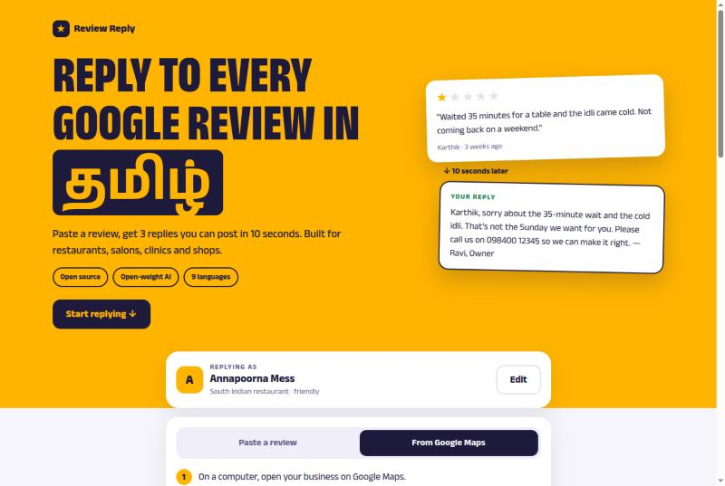

# Review Reply

Reply to every Google review in 10 seconds.

**Live:** https://review-reply-481.netlify.app



Small business owners (restaurants, salons, clinics, shops) get Google reviews and rarely reply, because writing replies is tedious and a bad reply to a 1-star review does more harm than no reply. Paste a review, pick the star rating and language, and get three ready-to-post replies (short, standard, warm). Copy one into Google Business Profile.

**Import from Google Maps:** copy your business page from Google Maps (select all, copy) and paste it in. The app fills in your business details and lists the reviews that have no "Response from the owner" yet, then writes replies for each. No Google account connection or API key needed. Star ratings aren't in Google's copied text, so they're estimated and you can correct them.

**Status:** works end to end locally. Tested so far against a temporary non-open model. Before submitting, switch `.env` to an open-weight model (see below).

## Run locally

```bash
npm install
cp .env.example .env   # then fill in the LLM_ values
npm run dev
npm run smoke          # runs every sample review through the model
```

## Environment variables

| Var | Meaning |
| --- | --- |
| `LLM_PROVIDER` | `google` (Gemini API, Gemma model) or `openai-compatible`. If unset: `openai-compatible` when `LLM_BASE_URL` is set, else `google` |
| `LLM_API_KEY` | Key for that provider |
| `LLM_MODEL` | An open-weight model ID, e.g. a Gemma instruct model |
| `LLM_BASE_URL` | Only for `openai-compatible` (Groq, OpenRouter, Together…) |

The core model must be open-weight. Do not point this at Claude, GPT or Gemini.

## Deploy

Netlify builds with `npm run build` through `@sveltejs/adapter-netlify`. The site is connected to this repo: every push to `main` deploys to production automatically. Set the `LLM_*` variables in Netlify → Site configuration → Environment variables, then trigger a redeploy for them to take effect.

## Layout

```
src/lib/types.ts          shared types
src/lib/samples.ts        sample reviews, filtered by the chosen language
src/lib/server/prompt.ts  system + user prompt
src/lib/server/parse.ts   extract and validate the model's JSON
src/lib/server/llm.ts     the only file that knows the provider
src/lib/server/replies.ts prompt → model → parse, one retry
src/routes/api/reply/     POST: review → 3 replies
src/routes/api/import/    POST: pasted Google Maps page → business details + unreplied reviews
src/lib/ReplySlips.svelte the reply cards with copy buttons
src/env.ts                env var declarations (SvelteKit 3)
src/routes/+page.svelte   the whole UI
```

## Next (after launch)

Fetching reviews from Google, saving history, and accounts. Out of scope for this version.
